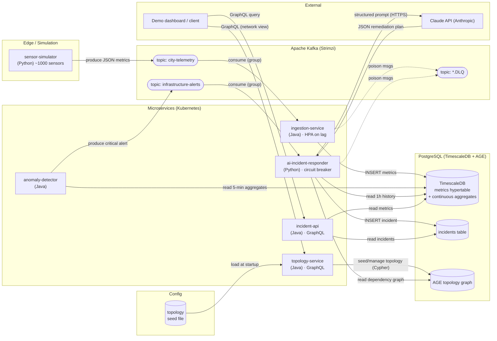
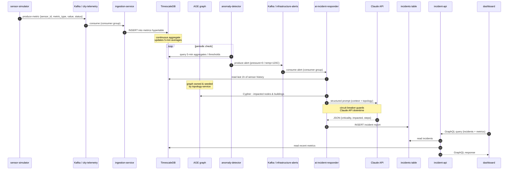

# Microservices & Communication

Definition of the services in the "Smart City" telemetry + AI incident-response system and how they communicate. This is a design document — no code exists yet. Source of truth: [`../project_architecture_and_plan.md`](../project_architecture_and_plan.md) and [`../technology_stack_topics.md`](../technology_stack_topics.md).

Diagram sources: [`architecture.mmd`](architecture.mmd) (component flowchart) and [`incident-response-sequence.mmd`](incident-response-sequence.mmd) (alert → remediation sequence).

## Design decisions

- **Anomaly detection is its own service** (`anomaly-detector`), decoupled from ingestion so write throughput and detection scale independently.
- **Assets & topology are owned by a dedicated `topology-service`**, not by ingestion. Managing the static network graph (assets = vertices, connections = edges) is a different concern from the high-throughput metric stream, and topology does not arrive via `city-telemetry`. `topology-service` is the **sole writer** of the AGE graph; `ingestion-service` is reduced to metrics-only.
- **A read-side API** (`incident-api`) exposes stored incidents and metrics for the demo dashboard **over GraphQL** — a single typed endpoint the dashboard queries for exactly the fields it needs.
- **One PostgreSQL instance hosts both the TimescaleDB and AGE extensions** — a single datastore with two logical roles (time-series + graph), not two separate databases.
- **Language:** Java is primary; Python is used for `sensor-simulator` (a lightweight generator script) and `ai-incident-responder` (Anthropic SDK / RAG code).
- **Communication:** pipeline services (`sensor-simulator`, `ingestion-service`, `anomaly-detector`, `ai-incident-responder`) talk **asynchronously over Kafka**; `topology-service` and `incident-api` are **request/response GraphQL** for external clients (dashboard/admin). Backend services never call each other directly — shared state lives in the single PostgreSQL instance and is read directly there.

## Services

| Service | Lang | Consumes | Produces / Writes | Reads | Scaling / resilience |
|---|---|---|---|---|---|
| **sensor-simulator** | Python | — | Kafka `city-telemetry` (JSON, keyed by `sensor_id`) | — | Load generator (design; not currently in the repo) |
| **ingestion-service** | Java | Kafka `city-telemetry` (consumer group) | metrics → TimescaleDB hypertable; poison msgs → DLQ | — | HPA on Kafka lag; idempotent consumer |
| **topology-service** | Java | — (seed file at startup) | AGE graph (Cypher); serves GraphQL responses | seed file; AGE graph | Sole writer of AGE; stateless API |
| **anomaly-detector** | Java | — (periodic poll) | Kafka `infrastructure-alerts` | TimescaleDB 5-min continuous aggregates / thresholds | Scheduled |
| **ai-incident-responder** | Python | Kafka `infrastructure-alerts` (consumer group) | Claude API call; `incidents` table INSERT; poison msgs → DLQ | TimescaleDB (1h history) + AGE (dependency graph) | Circuit breaker around Claude API; idempotent consumer |
| **incident-api** | Java | — | serves GraphQL responses | `incidents` table + TimescaleDB metrics | Stateless; horizontally scalable |

## Data infrastructure

- **Apache Kafka** (Strimzi operator) — topics:
  - `city-telemetry` — raw metric stream from the simulator.
  - `infrastructure-alerts` — critical events from the detector.
  - `*.DLQ` — dead-letter topics for poison messages (per Idempotent Consumer / DLQ patterns).
- **PostgreSQL** (single instance, TimescaleDB + AGE extensions):
  - TimescaleDB: `metrics` hypertable, `metrics_5m_avg` continuous aggregate, `incidents` table.
  - AGE: `city_topology` graph — vertices `Substation`, `DistributionNode`, `ResidentialBuilding`, `Sensor`; edges `PowerLine`, `Pipeline`, `SensorLink`. Written **only** by `topology-service` (seeded from `topology-service/src/main/resources/seed/city-topology.json`).

## Message & data contracts

**`city-telemetry` message (JSON), keyed by `sensor_id`:**
```json
{ "timestamp": "2026-07-21T12:00:00Z", "sensor_id": "s-0042", "metric_type": "pipe_pressure", "value": 3.2, "status": "OK" }
```

**`infrastructure-alerts` message (JSON):**
```json
{ "alert_id": "a-1001", "sensor_id": "s-0042", "metric_type": "pipe_pressure", "value": 0.0, "detected_at": "2026-07-21T12:05:00Z", "rule": "pressure==0" }
```

**`ai-incident-responder` → Claude API → `incidents` table (structured JSON):**
```json
{ "criticality": "HIGH", "impacted_objects": ["DistributionNode#5", "Building#12", "Building#19"], "remediation_steps": ["...", "..."] }
```

## Communication paths

1. `sensor-simulator` → **Kafka `city-telemetry`** — async produce, high volume, at-least-once.
2. **Kafka `city-telemetry`** → `ingestion-service` — consumer group; idempotent write.
3. `ingestion-service` → **TimescaleDB** — batched `INSERT` into the metrics hypertable (metrics only; no longer touches AGE).
4. seed file → `topology-service` → **AGE** — loads the topology at startup and manages it via Cypher; `topology-service` is the sole writer of the graph.
5. `anomaly-detector` → **TimescaleDB** — reads 5-min continuous aggregates / threshold rules.
6. `anomaly-detector` → **Kafka `infrastructure-alerts`** — async produce on critical breach.
7. **Kafka `infrastructure-alerts`** → `ai-incident-responder` — consumer group.
8. `ai-incident-responder` → **TimescaleDB** (last 1h history) + **AGE** (dependency graph) — context gathering (lightweight RAG); reads the AGE graph directly (owned by `topology-service`).
9. `ai-incident-responder` → **Claude API** — structured prompt over HTTPS; circuit breaker guards downtime.
10. `ai-incident-responder` → **`incidents` table** — persists the returned remediation plan.
11. `dashboard` → `incident-api` → **`incidents` table + TimescaleDB** — the dashboard sends a **GraphQL query**; `incident-api` resolves it with read-only SQL and returns the requested fields.
12. `dashboard` → `topology-service` → **AGE** — GraphQL query for the network/asset view (impacted objects, dependencies).

## Diagrams

### Component architecture


### Incident-response sequence

